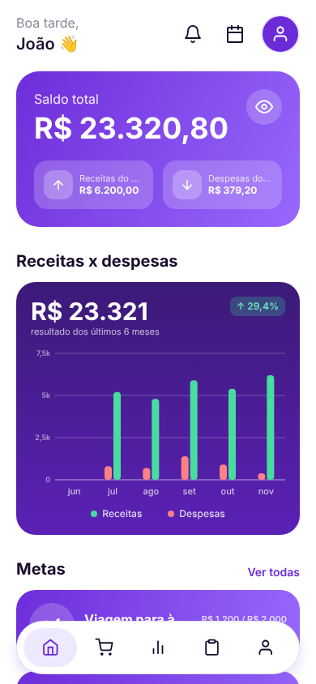
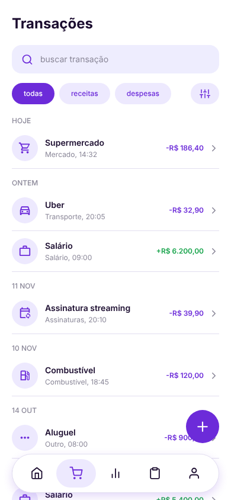
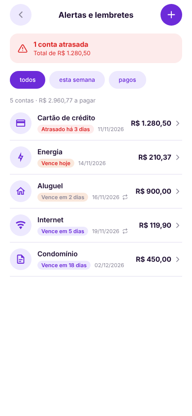
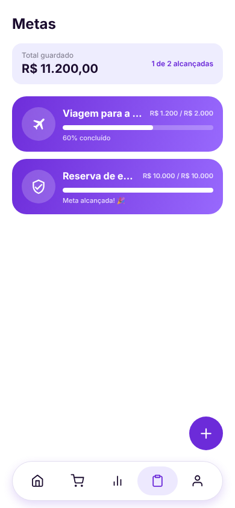
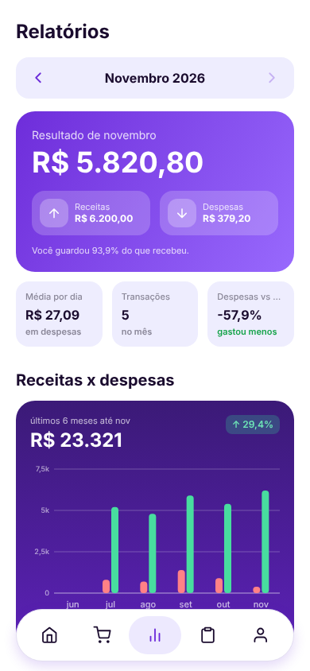
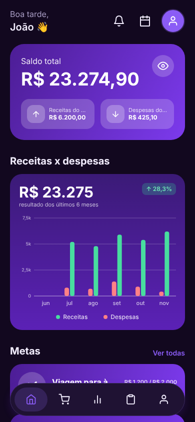

<div align="center">

# 💜 Secure Growth

**Controle financeiro pessoal simples, bonito e seguro, no seu celular.**


</div>

<p align="center">
  
  
  
  
  
</p>

## 📌 Sobre o projeto

O **Secure Growth** é um aplicativo mobile de finanças pessoais desenvolvido como **Projeto Integrador** do curso de
Engenharia de Software da **UNICEPLAC** (Brasília-DF). A ideia é que qualquer pessoa consiga registrar o que ganha e
gasta, acompanhar contas a pagar, guardar dinheiro para objetivos e entender para onde o dinheiro está indo, sem
planilhas e sem complicação.

O saldo é sempre **calculado a partir das transações** (receitas − despesas), então nunca fica desatualizado. Os
dados de cada usuário ficam isolados no banco por **Row Level Security (RLS)** do PostgreSQL.

## ✨ Funcionalidades

| Área | O que o app faz |
| --- | --- |
| 🔐 **Conta** | Cadastro com foto, login por e-mail e senha, **login com Google**, recuperação de senha por link, alterar senha |
| 💸 **Transações** | Receitas e despesas com categoria, busca, filtros por tipo e período, detalhes, edição e exclusão |
| 🏷️ **Categorias** | Catálogo único e reutilizável (seletor compartilhado por transações, lembretes e metas) |
| 📊 **Dashboard** | Saldo, receitas e despesas do mês, gráfico dos últimos 6 meses, metas e últimas transações, botão de ocultar valores |
| ⏰ **Lembretes** | Contas a pagar com situação (atrasado, vence hoje, em dia), recorrência mensal, "marcar como pago" e **notificação local** 3 dias antes e no dia do vencimento |
| 🎯 **Metas** | Objetivos com valor alvo, prazo, ícone, barra de progresso, depósitos/retiradas e aviso ao alcançar |
| 📈 **Relatórios** | Resumo por mês, comparação com o mês anterior, gráfico de 6 meses, despesas/receitas por categoria e maiores gastos |
| 📤 **Exportação** | Relatório mensal em **PDF** e em **Excel (.xlsx)** com 3 planilhas, pronto para compartilhar |
| 🔔 **Notificações** | Central de alertas (transações, lembretes pagos, metas alcançadas, segurança) com lido/não lido |
| 👤 **Perfil** | Editar dados e foto, tema **claro / escuro / sistema**, ocultar valores, sair da conta |

> Os valores e nomes mostrados nos prints são **fictícios**, gerados só para demonstração.

<details>
<summary><b>Ver tema escuro e tela de login</b></summary>
<br />
<p align="center">
  
  
</p>
</details>

## 🧱 Tecnologias

- **App:** React Native + [Expo](https://expo.dev) (SDK 58) com **Expo Router** (rotas baseadas em arquivos)
- **Linguagem:** TypeScript em modo estrito
- **Estilo:** NativeWind 4 (Tailwind) com tema por variáveis CSS (claro/escuro)
- **Estado e dados:** TanStack Query (cache e requisições) e Zustand (estado local)
- **Backend:** [Supabase](https://supabase.com): Auth (PKCE), PostgreSQL com RLS e triggers, Storage (fotos de perfil)
- **Recursos nativos:** `expo-notifications`, `expo-print`, `expo-sharing`, `expo-image-picker`, `expo-web-browser`
- **Exportação:** `xlsx` (SheetJS) para Excel e HTML → PDF com `expo-print`
- **Testes:** `node:test` para a lógica pura (saldo, relatórios, lembretes, metas)

## 🗂️ Estrutura de pastas

```
.
├── .github/        Template de Pull Request e workflow de CI
├── assets/         Ícones, splash e logos do app
├── docs/           Documentação (wireframes, casos de uso, diagramas, regras de negócio) e prints
├── src/
│   ├── app/        Telas e rotas (Expo Router): (auth), (app), (tabs)
│   ├── components/ Componentes reutilizáveis
│   ├── constants/  Constantes e paleta do tema
│   ├── hooks/      Hooks de dados e de interface
│   ├── lib/        Regras de negócio puras, exportação, integrações
│   ├── store/      Estado local (Zustand)
│   └── types/      Tipos TypeScript
├── supabase/       Migrations SQL (schema, RLS, triggers) e correções
└── tests/          Testes unitários da lógica de negócio
```

## 🚀 Como rodar o projeto

### Pré-requisitos

- [Node.js](https://nodejs.org) **22 ou mais novo**
- Um projeto gratuito no [Supabase](https://supabase.com)
- App **Expo Go** no celular (Android ou iOS), na **mesma rede Wi-Fi** do computador

### 1. Clonar e instalar

```bash
git clone https://github.com/andreluiz-systems/APP-Finceiro_SecureGrowth.git
cd APP-Finceiro_SecureGrowth
npm install --legacy-peer-deps
```

### 2. Configurar as variáveis de ambiente

Copie o modelo e preencha com os dados do seu projeto (Supabase → *Project Settings → API Keys*):

```bash
cp .env.example .env
```

```env
EXPO_PUBLIC_SUPABASE_URL=https://SEU-PROJETO.supabase.co
EXPO_PUBLIC_SUPABASE_KEY=sb_publishable_xxxxxxxxxxxxxxxx
```

> ⚠️ Use **somente** a *publishable key*. Nunca coloque a *secret key* no app, e o arquivo `.env` não vai para o GitHub.

### 3. Criar o banco de dados

No Supabase, abra **SQL Editor → New query**, cole o conteúdo de
[`supabase/migrations/20261113000000_init_schema.sql`](supabase/migrations/20261113000000_init_schema.sql) e clique em
**Run** (uma única vez, em um projeto novo). Isso cria as tabelas, as políticas de segurança (RLS), os triggers e o
bucket `avatars` das fotos de perfil.

### 4. Configurar a autenticação (Supabase → Authentication)

- **Sign In / Providers → Email:** senha mínima de 8 caracteres.
- **Sign In / Providers → Email:** deixe *Confirm email* **desligado** durante o desenvolvimento.
- **URL Configuration → Redirect URLs:** adicione `exp://**` (Expo Go) e `securegrowth://**` (app instalado).
- **URL Configuration → Site URL:** `exp://SEU-IP:8081/--/nova-senha` (o IP do seu computador na rede). Sem isso o
  link de recuperação de senha não abre o app.

<details>
<summary><b>Login com Google (opcional)</b></summary>

1. No [Google Cloud Console](https://console.cloud.google.com), em *Google Auth Platform*, crie um **OAuth client**
   do tipo *Web application*.
2. Em *Authorized redirect URIs*, coloque a **Callback URL** que o Supabase mostra em
   *Authentication → Sign In / Providers → Google*.
3. Copie o *Client ID* e o *Client Secret* para o painel do provedor Google no Supabase e ative-o.
4. Enquanto o app do Google estiver em modo *Testing*, adicione os e-mails de teste na tela de consentimento.

> Guarde o *Client Secret* apenas no painel do Supabase. Ele nunca deve aparecer no código nem em prints.

</details>

### 5. Iniciar

```bash
npx expo start
```

Escaneie o QR Code com o Expo Go (Android) ou com a câmera (iOS). Na primeira vez o Expo pode pedir
`npx expo login`.

## 🧪 Testes e qualidade

```bash
npm run typecheck   # checagem de tipos (TypeScript estrito)
npm test            # testes da lógica de negócio (Node 22+)
```

A lógica de saldo, relatórios, lembretes e metas fica em funções puras em `src/lib/`, sem dependência do React
Native, o que permite testá-las rapidamente. O **CI** do GitHub Actions roda os dois comandos a cada push e Pull
Request.

## 🔒 Segurança

- **RLS em todas as tabelas:** cada usuário só lê e altera os próprios registros (`auth.uid() = user_id`).
- **Chaves:** o app usa apenas a *publishable key*. Nenhuma chave secreta é versionada (`.env` está no `.gitignore`).
- **Auth com PKCE** e troca de senha exigindo a senha atual.
- **Fotos de perfil** em bucket do Storage em que cada usuário só envia e altera arquivos na própria pasta.
- **Triggers** criam o perfil, as notificações e os lembretes recorrentes no próprio banco.

## 🗃️ Modelo de dados

`profiles` · `categories` · `transactions` · `reminders` · `goals` · `notifications`

O saldo **não é guardado**: é a soma das receitas menos as despesas. O botão "Marcar como pago" dos lembretes é uma
**confirmação do próprio usuário**, sem integração bancária.

## 🌿 Fluxo de trabalho (Git Flow simplificado)

- `main`: versão estável e testada (protegida).
- `develop`: integração das novas funcionalidades (protegida).
- `feature/*`, `docs/*`, `fix/*`: branches de trabalho criadas a partir da `develop` e integradas por **Pull Request**.
- Versões marcadas com tags de versionamento semântico (ex.: `v0.1.0-alpha`).

O passo a passo completo está em [`docs/guia-git-flow.md`](docs/guia-git-flow.md).

## 👥 Equipe

| Nome | Papel | GitHub |
| --- | --- | --- |
| André Luiz Pereira de Sousa | Desenvolvimento | [@andreluiz-systems](https://github.com/andreluiz-systems) |

## 🎓 Contexto acadêmico

Projeto Integrador, Engenharia de Software, **UNICEPLAC** (Centro Universitário do Planalto Central Apparecido dos
Santos), Brasília-DF, 2026.

## 📄 Licença

Distribuído sob a licença **MIT**. Veja o arquivo [LICENSE](LICENSE).
